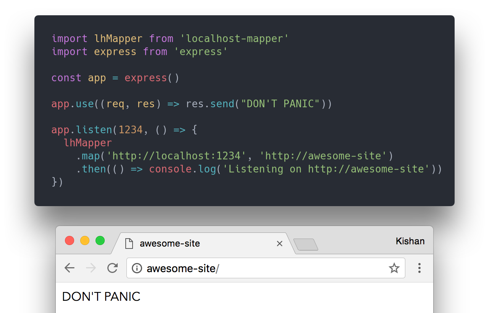

# 

[](https://github.com/KishanBagaria/localhost-mapper/actions/workflows/ci.yml)
[](https://www.npmjs.com/package/localhost-mapper)
[](LICENSE.txt)

🔗 Run your dev servers on addresses like `https://awesome-site/` or `https://🍔/`<sup>[1](#fn1)</sup> instead of ugly addresses like `http://localhost:1337`



You can run your localhost servers on practically any address like:  
`http://cat.meow/`  
`http://🍎🦄.👩‍💻/`<sup>[1](#fn1)</sup>  
`https://my.awesome.site/` ([HTTPS](#newAddress) will automatically be supported even if your original server listens only on HTTP)

Works on macOS and Windows, and [Linux with some manual config](#linux).

## Install

```sh
$ npm install --save-dev localhost-mapper
```

Requires **Node.js 22.12 or newer**. The package ships as ESM with TypeScript
type definitions included.

## Usage

Import the module and use it like:
```js
import lhMapper from 'localhost-mapper'
// named exports work too: import { map, unmap } from 'localhost-mapper'

// [...] your server code here [...]

const { PORT = 31415 } = process.env
await lhMapper.map(`http://localhost:${PORT}`, 'http://awesome-site')
console.log('listening on http://awesome-site')

// now open http://awesome-site in a browser
```

or type in the following in a terminal:
```sh
$ lh-map http://localhost:31415 http://awesome-site
```

```
Usage
  $ lh-map <original_address> <new_address> [options]

Options
  --regex       Treat <new_address> as a regular expression
  --open        Open new URL in default browser
  --no-proxy    Disable proxying

  --cert        File path of cert file to use for HTTPS
  --key         File path of key file to use for HTTPS
```

## How It Works

Most local-domain tools work at the **DNS layer**: they make a hostname resolve to
`127.0.0.1` (via `/etc/hosts`, dnsmasq, or a reserved TLD) and then run a reverse proxy
on ports 80/443 to route by `Host` header. That means binding privileged ports, and it
means every hostname you want has to be resolvable somehow.

localhost-mapper works one layer up, at the **proxy layer**, using a
[Proxy Auto-Config (PAC)](https://en.wikipedia.org/wiki/Proxy_auto-config) file — a small
JavaScript function the OS and browsers call for every request to ask "direct, or through
a proxy?":

```js
function FindProxyForURL(url, host) {
  if (url.indexOf('http://awesome-site/') === 0) return 'PROXY localhost:54321'
  return 'DIRECT'
}
```

The browser asks this **before** resolving DNS, so the hostname never has to exist — no
`hosts` entry, no DNS server, no reserved TLD, nothing on port 80. Any name works.

So `map('http://localhost:1337', 'http://awesome-site')`:

1. **Starts a proxy** on a random free port, forwarding to your dev server. It rewrites
   the outgoing `Host` header back to `localhost:1337`, so your app sees what it always
   did — no host allowlist to update. ([`proxy: false`](#proxy-boolean) forwards the new
   hostname through instead.)
2. **Adds a line to the PAC file** pointing `http://awesome-site/` at that port. If you
   already had a PAC configured, it's [chained](#chaining-an-existing-pac) so unmatched
   URLs keep following it. A single PAC server per machine (started on demand, preferring
   port 1122) serves the result, at a URL containing a hash of the contents — so an
   updated mapping is never served from cache.
3. **Points the OS proxy setting at that URL** — `networksetup -setautoproxyurl` on macOS,
   the `AutoConfigURL` registry value on Windows — backing up your previous setting first.
4. **Undoes all of it on exit.** When the machine's last mapping goes away, your original
   proxy setting is restored and the PAC server shuts down.

Mappings are stored keyed by process ID, so several projects can map addresses
simultaneously and mappings owned by dead processes get cleaned up automatically.

For `https:` addresses the browser sends `CONNECT awesome-site:443` instead of a plain
request; localhost-mapper answers it and splices the connection into a local TLS server
using a generated self-signed certificate. So HTTPS works even if your dev server only
speaks HTTP.

### Trade-offs

<a name="linux"></a>

* **Non-PAC clients don't see mappings.** [cURL][curl-pac] and Wget don't support PAC
  files. This is a browser-facing tool.
* **Self-signed certificates** aren't added to your trust store, so browsers warn on
  HTTPS mappings. Pass your own via the [`ssl` option](#options-object) to avoid it.
* **Linux needs manual setup** — point your browser or OS at the PAC URL yourself.

### Chaining an existing PAC

localhost-mapper takes over the system-wide PAC setting, which would normally knock out
any proxy auto-config you already had — a real problem on corporate networks. So it
doesn't replace yours, it wraps it: your PAC is fetched and inlined into the generated
file, and any URL that matches none of your mappings falls through to it.

```js
var __lhUpstream = (function () {
  /* your existing PAC, wrapped so its FindProxyForURL stays local */
})()
function __lhFindProxyForURL(url, host) {
  if (url.indexOf('http://awesome-site/') === 0) return 'PROXY localhost:54321'
  if (__lhUpstream) { try { return __lhUpstream(url, host) } catch (e) {} }
  return 'DIRECT'
}
var FindProxyForURL = __lhFindProxyForURL
```

Worth knowing:

* Your PAC is **snapshotted** when the first mapping is created, not re-fetched per
  request. Changes upstream aren't picked up until you restart.
* If it can't be fetched (corporate PAC URLs are often VPN-only), doesn't parse, or throws
  at runtime, unmatched URLs fall back to `DIRECT` — the behaviour you'd get without
  chaining. It never fails the mapping.
* Set `LOCALHOST_MAPPER_NO_PAC_CHAIN=1` to turn it off.

## Comparison with Other Tools

|                                   | localhost-mapper              | [portless][portless]                  | DNS-layer ([Valet][valet], [Traefik][traefik]) |
| --------------------------------- | ----------------------------- | ------------------------------------- | ---------------------------------------------- |
| How the hostname resolves         | PAC — no DNS involved         | `.localhost`, else syncs `/etc/hosts` | DNS resolver or `/etc/hosts`                   |
| Any hostname you like             | ✅ including emoji            | Under a TLD it manages                | Under a TLD you configure                      |
| Needs port 80/443 free            | ❌                            | ✅                                    | ✅                                             |
| HTTPS                             | Self-signed → browser warning | Local CA, auto-trusted, HTTP/2        | Trusted local certificate                      |
| Changes how you start your server | ❌ one line, or run alongside | ✅ launched via `portless …`          | ✅ register the app                            |
| Works with cURL / Wget            | ❌                            | ✅                                    | ✅                                             |

[portless][portless] is the closest modern equivalent and the better default: it trusts a
local CA, so no certificate warnings, and cURL works. The trade is that it owns your dev
server's lifecycle and your hostnames live under a TLD it manages. Reach for
localhost-mapper when you want an arbitrary hostname — any name, any TLD, emoji included —
wired up with one line inside a process you already start, without touching DNS or binding
a privileged port.

Tunnels (ngrok, cloudflared, Tailscale Funnel) solve a different problem: reaching your
server from the internet. localhost-mapper is purely local.

### Why not simply edit the `/etc/hosts` file?

The `hosts` file cannot map to different ports. So you can map `http://localhost:1337` → `http://unicorns:1337` easily but not `http://localhost:1337` → `http://unicorns` without listening on port 80. Listening on port 80 requires sudo.

Since you can only get one server to listen on port 80, the `hosts` file is limited to just a single mapping. With localhost-mapper, you can map as many hosts as you want simultaneously (`http://localhost:31415` → `https://alice`, `http://localhost:1234` → `http://bob`).

Manually editing the `hosts` file is a lot of work, compared to localhost-mapper which can be used by just adding a line of code that you can forget about. localhost-mapper will only be active when you run code that imports it. It'll restore all filesystem/network changes when it's not being used.

When you share your code, other people will have to manually edit the `hosts` file on their environment, but with localhost-mapper they can start using the prettified domain out of the box as soon as they run the code.

## API

#### `localhostMapper.map(originalAddress: String, newAddress: String|Array<String>|RegExp, [options: Object]): Promise<void>`

Forwards `originalAddress` to `newAddress` (`http://localhost:1337` → `http://cat.meow`). Aliased as `localhostMapper.add`.

##### `originalAddress: String`

The original address to be proxied/forwarded to `newAddress`. Like `http://localhost:1337`.

<a name="newAddress"></a>
##### `newAddress: String|Array<String>|RegExp`

The new address to listen on. Like `http://awesome-site`. Pass in an array of strings to listen on multiple addresses in one call. Also supports regex, like `/http\:\/\/.*everything\.awesome/`

If this starts with `https:`, self-signed certificates will be generated and a HTTPS server will be created that proxies `originalAddress`. So HTTPS will work even if `originalAddress` listens only on HTTP. To use your own certs, check out the `ssl` option below.
If you pass in a `RegExp` that matches HTTPS domains, you must set `ssl` to `true` to use automatically generate and use self-signed certificates.

##### `options: Object`

```js
{
  proxy: Boolean,
  proxyConfig: Object,
  ssl: {
    key: String,
    cert: String
  }
}
```

###### `proxy: Boolean`

By default, localhost-mapper proxies `originalAddress` and rewrites the `Host` header your server receives back to `originalAddress`, so it stays what your app already expects (`localhost:1337`, not `awesome-site`). This keeps it compatible with codebases that would otherwise need changes — anything doing host allowlisting or virtual-host routing.

Setting this to `false` disables proxying, and the new hostname reaches your server as-is.

###### `proxyConfig: Object`

Passed as-is to [http-proxy-3][http-proxy]. Only applicable when `proxy` is not `false`.

###### `ssl: { key: String, cert: String }`

Contents of key/cert file to use for HTTPS. Set this to `true` to automatically generate and use self-signed certificates.

#### `localhostMapper.unmap(newAddress: String|Array<String>|RegExp): Promise<void>`

Undos the `localhostMapper.map(...)` call, i.e. stops listening for `newAddress`. All addresses will automatically be removed when the node process exits. Aliased as `localhostMapper.remove`.

Cleanup runs on `beforeExit`, `SIGINT` and `SIGTERM`. A bare `process.exit()` gives no chance to run it — if you need to exit explicitly, use [`gracefulExit()`](https://github.com/sindresorhus/exit-hook#gracefulexitsignal) from `exit-hook`.

## Development

```sh
$ npm install
$ npm test                  # lint, typecheck, build, unit tests
$ npm run test:integration  # drives a real browser through the OS proxy config
$ npm run format            # apply Biome's lint fixes and formatting
$ npm run watch             # rebuild on change
```

Linting and formatting are both [Biome](https://biomejs.dev); there's no ESLint or
Prettier. Style rules live in `biome.json`.

`npm run test:integration` changes your machine's proxy auto-config settings, so it
needs the permissions to do so and isn't run in CI. If a run is interrupted and
leaves settings behind, `test/cleanup.sh` resets them (macOS).

---

<a name="fn1">[1]</a>: While all browsers support emoji domains, not all show the actual emoji in the address bar. Safari will show the emoji like you'd want it to, while Chrome and Firefox will show the Punycode version: `http://xn--ui8h/`

## Acknowledgements

* [winproxy](https://github.com/getlantern/winproxy) for the executable to change PAC URL automatically in Windows (licensed under [Apache-2.0](https://github.com/getlantern/winproxy/blob/master/LICENSE))
* [hotel](https://github.com/typicode/hotel) for the inspiration

## License

MIT © [Kishan Bagaria](https://kishanbagaria.com)

[curl-pac]: https://curl.se/docs/faq.html#does-curl-support-javascript-or-pac-automated-proxy-config
[http-proxy]: https://www.npmjs.com/package/http-proxy-3
[portless]: https://github.com/vercel-labs/portless
[valet]: https://laravel.com/docs/12.x/valet
[traefik]: https://traefik.io
